# ArsyWatch

Your WiFi is slow. You open the router page, see a channel dropdown, and it tells
you nothing about why. So you guess.

ArsyWatch is a small box that listens to the WiFi in the air around your house and
shows you what is actually going on. How many routers are shouting on each channel.
How many phones and laptops are nearby. Which channel is the crowded one, so you
know which one to move to.

It is a software project for **Stardance Challenge 2026**.

**Live demo: [arsywatch.arsyads.dev](https://arsywatch.arsyads.dev)** — no login, real data.



---

## The problem, in plain words

WiFi runs on channels. Think of them like lanes on a road. Channel 1, channel 6,
channel 11, and so on up to 13. If your router sits in a lane that ten other routers
also use, everyone talks over each other and everything gets slow.

Your router will let you pick a lane. It just will not tell you which lanes are busy.
That information is invisible unless you go looking for it with the right hardware.

ArsyWatch is that listener. It counts, and puts the answer on a web page.

---

## What it actually does

- **Listens to the air.** The chip hops through channels 1 to 13, spending about
  0.3 seconds on each, and writes down every router it hears: its name, its signal
  strength, its channel, its security type.
- **Counts the devices.** In the same pass, it catches the little "hello, is anyone
  there?" messages that phones and laptops constantly broadcast while looking for
  networks. Each one carries a MAC address. ArsyWatch counts the unique ones.
- **Sends the numbers home.** Every 30 seconds it posts a small JSON summary to a
  server.
- **Shows you a live page.** The server keeps the history in a single SQLite file
  and pushes updates to your browser. No refresh button. The page just changes.

---

## What it does NOT do

Being clear about this matters more than the feature list.

- It does **not** read your internet traffic. It only listens to the management
  chatter that routers and devices broadcast in the open. No websites, no messages,
  no content.
- It does **not** store MAC addresses. Each one is hashed with a secret salt the
  moment it arrives, and the original is thrown away. Only the count survives.
- It does **not** crack passwords or join networks. It never transmits on WiFi. It
  is a listener, not a participant.
- It can **only** see 2.4 GHz. The ESP8266 radio is 2.4 GHz only, so 5 GHz networks
  are completely invisible to it. If your router does both, you will only ever see
  the 2.4 GHz half.

That last one is a hardware limit, not a bug. It is written here so nobody is
surprised later.

---

## How it is built

Five parts, all in this repo.

| Folder | What it is | Status |
|---|---|---|
| `firmware/` | The ESP8266 sketch that does the listening | compiles (`pio run` → 40% RAM, 37% flash) |
| `server/` | Node + Express + SQLite. Takes the data, stores it, serves it | **live**, 46 tests pass |
| `dashboard/` | The public web page | **live** at [arsywatch.arsyads.dev](https://arsywatch.arsyads.dev) |
| `deploy/` | systemd + nginx config for the VPS | applied |
| `docs/` | The API contract everything else follows | frozen |

The server and the dashboard are running on a VPS behind a Cloudflare Tunnel. The
firmware compiles and its exact payload has been verified against the live server (it
returns `201`), but it has **not yet run on the physical board** — that is the next step.

### The stack, and why

- **ESP8266** for the radio. It is cheap, it has WiFi, and it supports promiscuous
  mode, which is the trick that lets it hear other people's packets.
- **Node and Express** for the server. Plain and boring on purpose.
- **SQLite** instead of Postgres. One file, no separate server to run, and it
  handles this amount of data easily.
- **Server-Sent Events** for the live updates. One-way stream, no websocket
  complexity, reconnects on its own.
- **A single static HTML page** for the dashboard, not a framework. It is one
  read-only screen; a build step and a Node process would add weight and buy nothing.
- **Cloudflare Tunnel** for public access. No inbound ports are open on the VPS at
  all — `cloudflared` dials out, so there is no exposed attack surface.

### What it costs to run

| Process | Memory |
|---|---|
| Express + SQLite | ~56 MB |
| cloudflared | ~27 MB |
| nginx | ~20 MB |
| **Total** | **~103 MB** of 1 GB |

The dashboard itself costs nothing — it is a static file served from disk.

---

## Running the server

You need Node 20 or newer.

```bash
cd server
npm install
cp .env.example .env         # then edit it, see the table below
npm run seed -- --hours 24   # fake data so you have something to look at
npm start
```

Open `http://localhost:3000/api/v1/health`. You should get:

```json
{ "data": { "ok": true, "node_online": false, "last_scan_age_s": null, "sse_clients": 0 } }
```

`node_online` is `false` because no real chip is sending anything yet. That is
correct. The seed script fills the history tables, not the live ones.

### Environment variables

| Variable | What it is |
|---|---|
| `PORT` | Port to listen on. Default `3000`. |
| `DB_PATH` | Where the SQLite file lives. Default `./data/arsywatch.db`. |
| `DEVICE_TOKEN` | The secret the chip sends with every upload. **Change this.** |
| `ADMIN_USER` / `ADMIN_PASS` | Login for the admin pages. Leave the password empty and admin locks itself. |
| `MAC_SALT` | The secret used to hash MAC addresses. **Change this.** If someone knows your salt they can brute-force the hashes, because there are only about 2^48 possible MACs. |
| `TELEGRAM_BOT_TOKEN` / `TELEGRAM_CHAT_ID` | Optional. Alerts when a new router shows up. Off by default. |

If `MAC_SALT` is missing or still says `change-me`, the server warns you loudly. In
production it refuses to start.

### Try the API

```bash
# what is happening right now
curl 'http://localhost:3000/api/v1/aps?window=15m'

# how busy is each channel
curl 'http://localhost:3000/api/v1/channels?window=1h'

# how many unique devices over the last day
curl 'http://localhost:3000/api/v1/devices?window=24h'
```

Every endpoint is documented in [`docs/api.md`](docs/api.md).

---

## Tests

```bash
cd server
npm test
```

46 tests, all passing. They cover the boring important stuff: rejecting bad tokens,
rejecting malformed data with a clear message, making sure a raw MAC address can
never end up in the database, and making sure the admin pages lock when they should.

---

## Design

The dashboard follows [`DESIGN.md`](DESIGN.md). Short version: warm paper
background, one orange accent, monospace for every number so the columns do not
jitter when the values change. It deliberately does not look like the usual dark
neon dashboard.

You can see the tokens without building anything: open `design-preview.html` in a
browser.

---

## Where it is going

| When | What |
|---|---|
| done | API contract, server, tests, design system, deploy, dashboard |
| **next** | **Flash the ESP8266 and confirm real capture on the board** |
| then | Let it run for a week and validate the counts against reality |
| then | Demo video and timelapse for Stardance |

### The honest status

The dashboard is live but the page is empty until a node posts data. That is the one
gap left: the firmware has never run on real hardware. It compiles, and its exact
payload has been replayed into the live server to confirm a `201`, but promiscuous
capture on the physical chip is unproven.

If promiscuous mode turns out not to work on this board, the fallback is scan-only:
keep the access point list, drop the device count. That still ships.

The full plan, with the reasoning behind each decision, is in
[`ArsyWatch-PRD.md`](ArsyWatch-PRD.md). The API contract is
[`docs/api.md`](docs/api.md), and the deploy runbook is [`deploy/README.md`](deploy/README.md).

---

## Licence

MIT. See [`LICENSE`](LICENSE).
